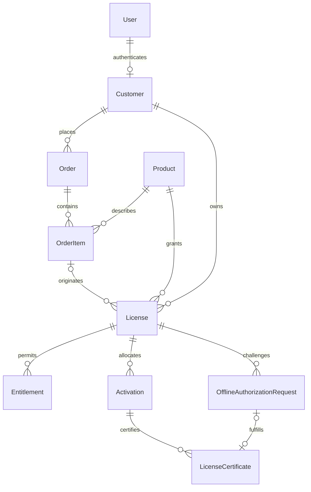

# Soundmine Platform architecture

Status: foundation, Boost tooling, invite-based onboarding and manual license workflows implemented. Plugin activation, signing and payments remain proposals.
The starting repository was commit `abc21b0`, containing only `README.md` (`# soundmine_platform`).

## Application boundaries

Use a modular monolith: one Laravel application and PostgreSQL database, with explicit business domains under `app/Domain`. This keeps transactional licensing operations in one place while avoiding premature services and duplicated customer data.

| Domain | Current records | Responsibility and future application actions |
| --- | --- | --- |
| Customers | Customer linked one-to-one to User; CustomerInvitation | Customer identity and ownership. User owns authentication; Customer owns commercial relationships. Organization memberships can be added separately. |
| Catalog | Product | Stable product slug and UUID, display metadata, availability. Rhythm Conductor is a catalog entry, never a special case in license code. Add product releases and editions when requirements settle. |
| Orders | Order, OrderItem | Commercial history, status, currency and integer minor-unit amounts. Items snapshot descriptions and prices. Future completion/refund actions coordinate license grants and revocations. No payment integration exists. |
| Licensing | License, LicenseStatus, LicenseEvent | A customer's grant for one product, optional purchase provenance, validity interval and device allowance. A grant can exist without an order for future trials or manual grants. |
| Entitlements | Entitlement | Named, structured rights scoped to a license, unique by `(license_id, key)`. Future actions validate feature keys against the product and calculate effective rights. |
| Activations | Activation, ActivationStatus | Installation allocation per license; unique `(license_id, machine_hash)`. Future activate/deactivate actions enforce device allowance under a license row lock. |
| OfflineAuthorization | OfflineAuthorizationRequest, LicenseCertificate | Expiring challenge records and immutable signed certificate history. No signer, authorization import/export or certificate issuance exists. |

`app/Models/User.php` is the shared authentication identity. Domain Eloquent models live under their respective `Models` directories. State enums are kept with the owning domain. Framework configuration, migrations and factories keep Laravel's conventional locations.

Put shared business use-case classes under `app/Domain/<Domain>/Actions`. Controllers, Livewire components, Filament resources and queued jobs should call those same actions. Keep state changes and business validation out of UI classes. Use policies for access control, request/DTO validation at boundaries, and database transactions for multi-record operations. Add interfaces for actual external boundaries (signing, payments), rather than wrapping every Eloquent query in a repository.

## Implemented interfaces

- `/admin`: Filament management of customers, invitations, products and licenses. Access requires `users.is_admin` and a verified email. The flag is excluded from mass assignment. There is no default administrator. Customer/product edits are limited; licenses are managed through the shared grant/status actions, with a dedicated history view and no raw editing/deletion.
- Customer portal: invite-only account creation, session login/logout, verification, password recovery, license list and license details. Queries derive the Customer from the authenticated User and return 404 for other customers’ license IDs. Login and recovery are throttled; password resets invalidate existing protected sessions. Verification and session middleware persist on Livewire updates. Public self-registration and admin MFA are not implemented.
- `GET /api/v1/status`: throttled, versioned service status; explicitly reports licensing unavailable.
- `/up`: Laravel health route. It is an application liveness signal, not a full dependency readiness check.

There are no plugin activation, entitlement mutation, order, checkout or certificate endpoints. All proposed endpoints below remain unregistered.

## Persistence decisions

Domain records use UUIDs; framework User IDs remain conventional big integers. UUIDs are identifiers, never authentication secrets. PostgreSQL is the supported database, including in tests. Structured rights and certificate payloads use JSONB. Domain times use timezone-aware timestamps; application time is UTC. Monetary values use integers and a currency code, never floats.

Foreign keys restrict destructive deletion of customer/commercial/licensing history. Product availability is an explicit flag; the seed creates Rhythm Conductor inactive. License state defaults to pending. The schema enforces unique per-license entitlements and installations, unique offline request digests, positive quantities/device limits and ordered validity dates. One offline request can link to at most one certificate. Certificate storage requires payload, signature, key identifier and validity dates, but does not verify signatures at this phase.

The schema is not a licensing enforcement engine. Future actions must enforce matching customer/product provenance for an order-linked license, matching license/machine for an offline certificate, valid status transitions, sums/currencies, expiry, supported product entitlements and activation counts. The admin UI writes manual grants and status transitions through `GrantManualLicense` and `ChangeLicenseStatus`, with PostgreSQL row locks and transactional audit insertion. It does not create purchase-linked grants, activations or certificates. Add cross-record constraints where useful as those workflows are implemented. A persisted `active` status alone must never be treated as sufficient authorization.

## Proposed online protocol (later phase)

1. Authenticate the customer or redeem a short-lived installation authorization. A public product ID, license UUID or machine hash is never sufficient authorization. Do not embed a reusable server secret in the plugin.
2. `POST /api/v1/activations`: validate the product, grant, status, time interval and normalized installation fingerprint. Lock the license row and allocate or reuse the installation atomically. Design idempotency and retry semantics before enabling this endpoint.
3. `GET /api/v1/entitlements`: authorize the caller and calculate effective rights through the same domain service used for certificates.
4. `DELETE /api/v1/activations/{id}`: authorize ownership and release the allocation according to the eventual device policy. Preserve the record for audit and retry handling.
5. Renewal returns a short-lived signed entitlement certificate. Apply request limits, input bounds, structured error codes and privacy-safe audit events. Test concurrent activations and cross-customer access against PostgreSQL before exposing writes.

Raw machine identifiers should not be stored; use a versioned, privacy-reviewed fingerprint scheme and digest. Hashing is not authentication and does not guarantee anonymity. Decide normalization, hardware-change tolerance and reinstall behavior with the JUCE client team.

## Proposed Ed25519 and offline authorization (later phase)

The intended certificate envelope is versioned, with an explicit algorithm and `key_id`, an exact encoded payload and an Ed25519 detached signature. Payloads should bind the issuer, certificate ID, license ID, product ID, installation fingerprint, effective entitlements, issue time and expiry. Exclude unnecessary customer personal data.

Specify canonical bytes, domain separation, binary/base64url encoding, timestamp units and schema compatibility before implementing PHP and JUCE verification. Maintain shared positive and negative test vectors for macOS and Windows. Never sign re-serialized JSON whose byte representation is ambiguous.

Offline flow proposal:

1. The plugin exports a bounded, versioned challenge containing product, machine fingerprint and a random nonce.
2. The authenticated customer uploads the challenge. Validate it, hash the request for replay detection, and store a short-lived request associated with that customer's license.
3. In one transaction, lock the request and license, check expiry/consumption, allocate a device through the same activation action, issue the certificate and mark the request consumed. Retries return the existing result, rather than consuming another seat.
4. The plugin imports and verifies the signed response against bundled trusted public keys and its own product/machine binding. Evaluate rights and expiry locally.

Private signing keys belong in a secret manager/HSM-backed signing boundary with rotation and audit, never in the repository, database, customer browser, plugin binary or Laravel's `APP_KEY`. Embed only verification public keys in the plugin. No keypair, signing credentials, key loading implementation or signer is created here. `config/soundmine.php` records the intended algorithm and unavailable capability; changing that flag cannot create missing workflows.

Offline revocation cannot be instantaneous. Decide maximum offline lifetime, renewal grace period, clock rollback handling, lost-device behavior and key rotation policy before shipping. The certificate table anticipates expiry/revocation history without promising that disconnected clients can observe current server state.

## Delivery phases

1. **Implemented:** framework, schema, relationships, PostgreSQL tests, Boost tooling and documentation.
2. **Implemented:** invite-based customer onboarding/recovery, verified portal access, management policies/resources and audited manual grants/status transitions.
3. Activation/entitlement actions and authenticated REST API, race/idempotency tests, protocol contract and JUCE interoperability tests.
4. Managed Ed25519 signing, key rotation, offline challenges/import/export, shared verification vectors and operational review.
5. Stripe checkout/webhooks and refund handling through Orders actions, with idempotent fulfillment and reconciliation.

No deployment or production readiness is implied by the foundation.
