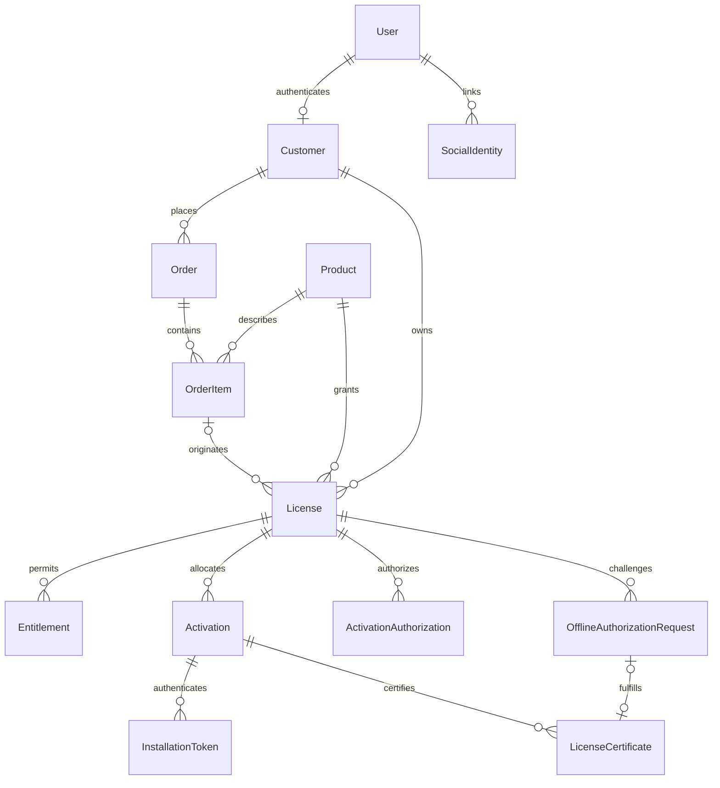

# TheSoundMine Platform architecture

Status: foundation, Boost tooling, invite-based onboarding and manual license workflows implemented. Product-scoped online activation and entitlement APIs are implemented as a preview. JUCE integration, signing and payments remain proposals.
The starting repository was commit `abc21b0`, containing only `README.md` (`# soundmine_platform`).

## Application boundaries

Use a modular monolith: one Laravel application and PostgreSQL database, with explicit business domains under `app/Domain`. This keeps transactional licensing operations in one place while avoiding premature services and duplicated customer data.

| Domain | Current records | Responsibility and future application actions |
| --- | --- | --- |
| Customers | Customer linked one-to-one to User; CustomerInvitation; SocialIdentity | Customer identity and ownership. User owns authentication; Customer owns commercial relationships. Organization memberships can be added separately. |
| Catalog | Product | Stable product slug and UUID, display metadata, availability. Pattern Conductor is a catalog entry, never a special case in license code. Add product releases and editions when requirements settle. |
| Orders | Order, OrderItem | Commercial history, status, currency and integer minor-unit amounts. Items snapshot descriptions and prices. Future completion/refund actions coordinate license grants and revocations. No payment integration exists. |
| Licensing | License, LicenseStatus, LicenseEvent | A customer's grant for one product, optional purchase provenance, validity interval and device allowance. A grant can exist without an order for future trials or manual grants. |
| Entitlements | Entitlement | Named, structured rights scoped to a license, unique by `(license_id, key)`. Future actions validate feature keys against the product and calculate effective rights. |
| Activations | Activation, ActivationStatus, ActivationAuthorization, InstallationToken | Installation allocation per license; unique `(license_id, machine_hash)`. Shared issuance/exchange/read/deactivation actions enforce customer/product scope and device allowance under a license row lock. |
| OfflineAuthorization | OfflineAuthorizationRequest, LicenseCertificate | Expiring challenge records and immutable signed certificate history. No signer, authorization import/export or certificate issuance exists. |

`app/Models/User.php` is the shared authentication identity. Domain Eloquent models live under their respective `Models` directories. State enums are kept with the owning domain. Framework configuration, migrations and factories keep Laravel's conventional locations.

Put shared business use-case classes under `app/Domain/<Domain>/Actions`. Controllers, Livewire components, Filament resources and queued jobs should call those same actions. Keep state changes and business validation out of UI classes. Use policies for access control, request/DTO validation at boundaries, and database transactions for multi-record operations. Add interfaces for actual external boundaries (signing, payments), rather than wrapping every Eloquent query in a repository.

## Implemented interfaces

- `/admin`: Filament management of customers, invitations, products and licenses. Access requires `users.is_admin` and a verified email. The flag is excluded from mass assignment. There is no default administrator. Customer/product edits are limited; licenses are managed through the shared grant/status actions, with a dedicated history view and no raw editing/deletion.
- Customer portal: invite-only account creation, session login/logout, verification, password recovery, license list, license details and installation authorization codes. Queries derive the Customer from the authenticated User and return 404 for other customers’ license IDs. Login and recovery are throttled; password resets invalidate existing protected sessions. Verification and session middleware persist on Livewire updates. Optional Google sign-in uses explicitly linked identities or invitation acceptance with a matching verified email. Account sign-in settings require the current password to link/disconnect Google. Public self-registration and admin MFA are not implemented.
- `GET /api/v1/status`: throttled, versioned service status; reports the online activation preview separately from unavailable signed/offline licensing.
- `/up`: Laravel health route. It is an application liveness signal, not a full dependency readiness check.

- `POST /api/v1/products/{product:slug}/activations`: exchange a customer-issued, installation-bound authorization code with an idempotency header.
- `GET /api/v1/products/{product:slug}/entitlements`: current rights for one installation bearer credential.
- `DELETE /api/v1/products/{product:slug}/activations/{activation}`: release only that credential's installation.

There are no entitlement mutation, order, checkout, signing or certificate endpoints. The [activation API contract](activation-api.md) documents the implemented protocol and its limits.

## Customer identity boundary

`SocialIdentity` belongs to User, not to a product or license. One linked Google account authenticates the existing customer across their independently scoped products; it does not change customer ownership, entitlements or installation credentials. Unique provider/subject and user/provider pairs prevent identity sharing and accidental replacement.

`AuthenticateGoogleCustomer` owns linked-subject lookup, explicit linking, invitation provisioning and unlinking. It never auto-links by email, changes an existing user's email, or grants administrator privileges. New Google accounts still require a valid invitation and verified matching provider email. Account creation, Customer creation, identity insertion and invitation consumption commit together. Existing-user link/unlink and login checks use User row locks. Google authentication is refused for administrators, unverified local customers and users without a Customer record.

The HTTP controller handles Socialite state/PKCE, CSRF-protected initiation, ten-minute single-use session intent and session rotation. Linking additionally binds the current user and password version after password confirmation. Provider credentials live only in environment configuration; access/refresh tokens are never persisted. Google is disabled until explicitly configured. See README for setup, recovery behavior and the remaining live-provider verification step.

## Persistence decisions

Domain records use UUIDs; framework User IDs remain conventional big integers. UUIDs are identifiers, never authentication secrets. PostgreSQL is the supported database, including in tests. Structured rights and certificate payloads use JSONB. Domain times use timezone-aware timestamps; application time is UTC. Monetary values use integers and a currency code, never floats.

Foreign keys restrict destructive deletion of customer/commercial/licensing history. Product availability is an explicit flag; the seed creates Pattern Conductor inactive. License state defaults to pending. The schema enforces unique per-license entitlements and installations, unique offline request digests, positive quantities/device limits and ordered validity dates. One offline request can link to at most one certificate. Certificate storage requires payload, signature, key identifier and validity dates, but does not verify signatures at this phase.

The schema is not a licensing enforcement engine. Future actions must enforce matching customer/product provenance for an order-linked license, matching license/machine for an offline certificate, valid status transitions, sums/currencies, expiry, supported product entitlements and activation counts. The admin UI writes manual grants and status transitions through `GrantManualLicense` and `ChangeLicenseStatus`, with PostgreSQL row locks and transactional audit insertion. It does not create purchase-linked grants or certificates. Activation actions separately enforce current verified ownership, product availability, license status/dates, token validity and per-license active allocation counts. Add cross-record constraints where useful as those workflows are implemented. A persisted `active` status alone must never be treated as sufficient authorization.

## Online activation boundaries

The customer portal issues a ten-minute authorization bound to the selected license, customer, product, installation hash and platform. The exchange request cannot choose its customer or license. Installation tokens snapshot customer/product ownership and authenticate exactly one activation; reassignment does not let an old token follow the license. UUIDs, slugs, hashes and account sessions never substitute for installation authentication.

All activation mutations and entitlement reads lock the license row first, then the relevant grant/token/activation. This serializes quota checks, retries, credential rotation and administrative license status changes. Separate PHP processes test final-seat contention, duplicate requests and concurrent products against PostgreSQL. Product availability and customer verification are read anew for online rights; their changes take effect on subsequent requests. They are not serialized by the license lock.

Idempotency is scoped to one short-lived authorization code. An exact retry with the same UUID header and normalized payload retrieves the same live credential, while different input is rejected. The credential is digested in `installation_tokens`; a temporary encrypted copy on the authorization permits recovery after a lost response. Expired authorizations are unusable immediately and pruned hourly. License expiry, suspension, revocation, token rotation and deactivation also prevent stale replay. Rights are recalculated instead of replaying a cached entitlement response.

The installation identifier is a persisted random client UUID, hashed with a version prefix. It represents an installation, not verified hardware; copying both its state and bearer token can impersonate that installation. No device attestation or hardware tolerance is promised. Products have independent licenses, quotas, tokens and entitlement key namespaces. Future edition/release definitions should remain catalog data rather than product-specific branches in these actions.

This preview returns online JSON rights, with no signed certificate or offline grant. Token renewal currently requires another portal authorization; customer device recovery and JUCE interoperability fixtures remain follow-up work.

## Proposed Ed25519 and offline authorization (later phase)

The intended certificate envelope is versioned, with an explicit algorithm and `key_id`, an exact encoded payload and an Ed25519 detached signature. Payloads should bind the issuer, certificate ID, license ID, product ID, installation fingerprint, effective entitlements, issue time and expiry. Exclude unnecessary customer personal data.

Specify canonical bytes, domain separation, binary/base64url encoding, timestamp units and schema compatibility before implementing PHP and JUCE verification. Maintain shared positive and negative test vectors for macOS and Windows. Never sign re-serialized JSON whose byte representation is ambiguous.

Offline flow proposal:

1. The plugin exports a bounded, versioned challenge containing product, machine fingerprint and a random nonce.
2. The authenticated customer uploads the challenge. Validate it, hash the request for replay detection, and store a short-lived request associated with that customer's license.
3. In one transaction, lock the request and license, check expiry/consumption, allocate a device through the same activation action, issue the certificate and mark the request consumed. Retries return the existing result, rather than consuming another seat.
4. The plugin imports and verifies the signed response against bundled trusted public keys and its own product/machine binding. Evaluate rights and expiry locally.

Private signing keys belong in a secret manager/HSM-backed signing boundary with rotation and audit, never in the repository, database, customer browser, plugin binary or Laravel's `APP_KEY`. Embed only verification public keys in the plugin. No keypair, signing credentials, key loading implementation or signer is created here. `config/soundmine.php` records the intended algorithm and unavailable capability; changing that flag cannot create missing workflows.

Offline revocation cannot be instantaneous. Decide maximum offline lifetime, renewal grace period, clock rollback handling, lost-device behavior and key rotation policy before shipping. The certificate table anticipates expiry/revocation history without promising that disconnected clients can observe current server state.

## Delivery phases

1. **Implemented:** framework, schema, relationships, PostgreSQL tests, Boost tooling and documentation.
2. **Implemented:** invite-based customer onboarding/recovery, verified portal access, management policies/resources and audited manual grants/status transitions.
3. **Implemented:** product-scoped activation/entitlement actions and authenticated REST API, PostgreSQL race/idempotency tests and protocol contract. **Next:** JUCE client integration, cross-language fixtures, device recovery and renewal UX.
4. Managed Ed25519 signing, key rotation, offline challenges/import/export, shared verification vectors and operational review.
5. Stripe checkout/webhooks and refund handling through Orders actions, with idempotent fulfillment and reconciliation.

No deployment or production readiness is implied by the foundation.
